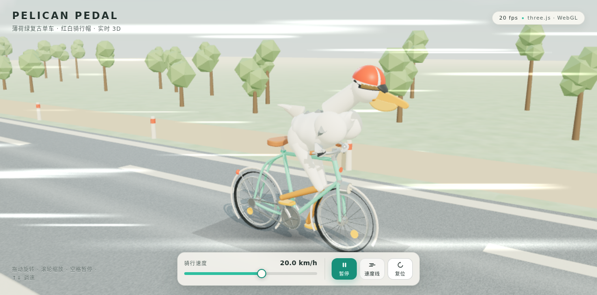

# Pelican Pedal · 鹈鹕骑行

一只戴着**红白骑行帽**和**太阳镜**的鹈鹕，骑着一辆**薄荷绿复古单车**在公路上飞驰。
纯前端的实时 3D 场景（three.js），可旋转、缩放并调节骑行速度。



## 运行

```bash
cd pelican
npm install          # 仅用于更新 vendor 里的 three.js 版本
npm run serve        # http://127.0.0.1:4173/
```

页面完全静态：`index.html` + `styles.css` + `src/*.js`，three.js 已 vendor 到
`vendor/`，因此**离线也能跑**，把它丢到任意静态服务器即可。

## 交互

| 操作 | 效果 |
| --- | --- |
| 拖动 | 环绕旋转场景 |
| 滚轮 / 双指 | 缩放 |
| 速度滑块 | 0 – 34 km/h，实时改变踩踏频率、镜头前倾与速度线 |
| 空格 | 暂停 / 继续 |
| ↑ ↓ | 调速 |
| L | 开关速度线 |
| R | 复位视角 |

## 实现要点

**自行车几何**（`src/bike.js`）
- 所有管件按真实尺寸建模：轴距 1.1 m、轮径 0.66 m、52° 头管角、曲柄 0.17 m。
- 轮胎是 LatheGeometry 车削剖面：深色胎面 + **奶油色侧壁**（复古胎）。
- 轮组含 18 根交叉编织辐条、轮毂挡片、辐条反光片；挡泥板、车灯、铜铃、
  皮革鞍座与棕皮革把套一应俱全。
- 传动系统是真的：牙盘 44 齿、后飞轮 18 齿、链条贴着两者公切线走。

**角色比例与踩踏**（`src/pelican.js`）
- 身体是一条**放样曲面**（`loftGeometry`），胸腹到颈部的过渡连续，没有"雪人"拼接感；
  灰色背部披羽直接用顶点色画在同一张皮上，避免第二层壳体的穿插与 z-fighting。
- 太阳镜是贴合头部的球壳片，红白骑行帽是半球冠 + 白色饰条 + 帽檐。
- 腿与翅膀都用**两骨解析 IK**（`solveIK2`）：脚永远踩在踏板上、翅膀永远握住车把，
  身体前倾/起伏时连接不会断。
- 髋关节在骨盆处，腿长 0.46 + 0.43 m，配合 1.05 m 的鞍座高度，
  正好在行程底部保持轻微屈膝、行程顶点膝盖高高抬起。

**动画**（`src/main.js`）
- 速度用帧率无关的指数平滑（`damp`）逼近目标值，所以拖动滑块不会有跳变。
- 车轮角度是**积分**出来的，不是直接赋值，变速时相位连续。
- 曲柄角由 `轮速 / 2.45` 得到，脚步、轮子、链条永远同步。
- 身体起伏是曲柄角的两倍频，点头是一倍频，幅度都随速度淡入淡出。

**世界**（`src/world.js`）
- 公路是一张 6 m 周期的程序生成贴图，靠滚动 `offset.x` 实现无限奔跑；
  树丛和路桩同样循环回收。
- 风线是 InstancedMesh 广告牌，会朝向相机、随速度拉长，并在贴近镜头时淡出，
  永远不会糊在角色脸上。
- 灯光：暖色主光（带阴影）+ 冷色天光轮廓光 + 地面反弹光 + 程序生成的
  equirect 环境贴图；ACES 色调映射。帧率低于阈值时自动降采样。

## 目录

```
pelican/
├── index.html          页面骨架 + importmap
├── styles.css          UI 样式
├── serve.js            零依赖静态服务器
├── src/
│   ├── main.js         渲染器、相机、状态机、UI 绑定
│   ├── config.js       自行车与角色的关键尺寸（两边共用）
│   ├── bike.js         自行车
│   ├── pelican.js      鹈鹕 + 绑定姿势
│   ├── world.js        公路、天空、灯光、速度线
│   ├── materials.js    材质与环境贴图
│   ├── palette.js      统一配色
│   └── utils.js        几何/数学工具（放样、锥形管、IK、合并）
├── tools/              截图与自检脚本
└── vendor/             three.js r170 + OrbitControls
```
